# 核心 ERD（v1）

```mermaid
erDiagram
    MARKET ||--o{ MARKET_LOCALE : has
    MARKET ||--o{ WAREHOUSE : maps
    MARKET ||--o{ STORE : contains
    MARKET ||--o{ PRICE_LIST : uses

    PRODUCT ||--o{ PRODUCT_TRANSLATION : translated
    PRODUCT ||--o{ SKU : has
    PRODUCT ||--o{ PRODUCT_MEDIA : has
    PRODUCT }o--|| CATEGORY : belongs
    PRODUCT ||--o{ PRODUCT_ATTRIBUTE_VALUE : has
    SKU ||--o{ SKU_OPTION_VALUE : composed
    SKU ||--o{ INVENTORY_BATCH : stocked_as
    SKU ||--o{ SUPPLIER_SKU : mapped

    WAREHOUSE ||--o{ INVENTORY_BATCH : holds
    STORE ||--o{ INVENTORY_BATCH : holds
    INVENTORY_BATCH ||--o{ STOCK_MOVE : moves
    INVENTORY_BATCH ||--o{ STOCK_LEVEL : projects
    INVENTORY_BATCH ||--o{ RESERVATION : reserved

    CART ||--o{ CART_LINE : contains
    CART_LINE }o--|| SKU : references

    ORDER ||--o{ ORDER_LINE : contains
    ORDER ||--o{ FULFILLMENT_ORDER : split_into
    ORDER ||--o{ PAYMENT : paid_by
    ORDER ||--o{ AFTER_SALE : after_sales
    AFTER_SALE ||--o{ AFTER_SALE_LINE : contains
    AFTER_SALE ||--o{ AFTER_SALE_EVENT : logs
    ORDER ||--o{ ORDER_ADDRESS : has
    ORDER_LINE }o--|| SKU : snapshot_of
    FULFILLMENT_ORDER ||--o{ FULFILLMENT_LINE : contains
    FULFILLMENT_ORDER ||--o{ PICK_TASK : requires
    FULFILLMENT_ORDER ||--o{ SHIPMENT : ships
    FULFILLMENT_ORDER }o--|| WAREHOUSE : from_warehouse
    FULFILLMENT_ORDER }o--|| STORE : from_store
    FULFILLMENT_ORDER }o--|| SUPPLIER : from_supplier

    PAYMENT ||--o{ PAYMENT_EVENT : emits
    PAYMENT }o--|| PAYMENT_CONNECTOR : uses
    SHIPMENT ||--o{ SHIPMENT_EVENT : tracks

    SUPPLIER ||--o{ SUPPLIER_SKU : offers
    SUPPLIER ||--o{ SUPPLIER_ORDER : receives
    SUPPLIER ||--o| SUPPLIER_CREDENTIAL : authenticates
    SUPPLIER ||--o{ SUPPLIER_STOCK_FEED : feeds
    SUPPLIER_ORDER ||--o{ SUPPLIER_ORDER_LINE : contains

    PURCHASE_ORDER ||--o{ PURCHASE_ORDER_LINE : contains
    PURCHASE_ORDER ||--o{ GOODS_RECEIPT : received_by
    GOODS_RECEIPT ||--o{ GOODS_RECEIPT_LINE : contains
    GOODS_RECEIPT ||--o{ INVENTORY_BATCH : creates
    TRANSFER_ORDER ||--o{ TRANSFER_LINE : contains
    STOCKTAKE ||--o{ STOCKTAKE_LINE : contains
    STOCK_TRANSFER ||--o{ STOCK_TRANSFER_LINE : contains
    STOCK_TRANSFER_LINE ||--o{ STOCK_TRANSFER_ALLOCATION : allocates
    INVENTORY_BATCH ||--o{ STOCK_TRANSFER_ALLOCATION : moved_from

    LEGAL_DOCUMENT ||--o{ LEGAL_DOCUMENT_VERSION : versions
    LEGAL_DOCUMENT_VERSION ||--o{ LEGAL_DOCUMENT_LOCALIZATION : localized
    LEGAL_DOCUMENT_VERSION ||--o{ LEGAL_ACCEPTANCE : accepted_as

    SUPPORT_CONVERSATION ||--o{ SUPPORT_MESSAGE : contains
    SUPPORT_CONVERSATION }o--|| CUSTOMER : belongs
    SUPPORT_CONVERSATION }o--o| AGENT : assigned

    ROLE_PERMISSION }o--|| PERMISSION : grants
    ANALYTICS_EVENT }o--|| ORDER : may_reference
    AUDIT_LOG }o--|| STAFF_USER : actor

    MEMBER ||--o{ POINTS_LEDGER : earns_or_redeems
    MEMBER ||--o{ MEMBER_CARD_LEDGER : stored_value
    MEMBER ||--o{ COUPON : owns
    MEMBER ||--o{ GROWTH_LEDGER : grows
    MEMBER }o--|| MEMBER_LEVEL : tier
    ORDER ||--o{ DISTRIBUTION_COMMISSION : generates
    REFERRAL_BINDING ||--o{ ORDER : attributes
    SUPPORT_CONVERSATION ||--o{ SUPPORT_TRANSFER : transfers
    STAFF_USER ||--o{ STAFF_STORE : bound_to
    PROMOTION ||--o{ PROMOTION_REDEMPTION : redeemed_by
    PROMOTION ||--o{ GROUP_BUY : spawns
    GROUP_BUY ||--o{ GROUP_BUY_MEMBER : contains
    ORDER ||--o| GROUP_BUY_MEMBER : joins
    STORE ||--o{ POS_SHIFT : runs
    STAFF_USER ||--o{ POS_SHIFT : cashier
    POS_SHIFT ||--o{ POS_SALE : contains
    POS_SHIFT ||--o{ POS_CASH_MOVEMENT : cash_flow
    POS_SALE ||--o{ POS_SALE_LINE : contains
    POS_SALE_LINE ||--o{ POS_SALE_ALLOCATION : allocates
    INVENTORY_BATCH ||--o{ POS_SALE_ALLOCATION : consumed_from
    POS_SALE ||--o{ POS_TENDER : paid_by
    POS_SALE ||--o{ POS_REFUND : refunded_by
    POS_REFUND ||--o{ POS_REFUND_LINE : itemizes
    POS_REFUND_LINE ||--o{ POS_REFUND_ALLOCATION : restores
    POS_REFUND ||--o{ POS_REFUND_TENDER : reverses
    COUPON ||--o{ COUPON_REDEMPTION : redeemed_as
    POS_SALE ||--o{ COUPON_REDEMPTION : uses
```

## 关键字段说明

- `PRODUCT.inventory_tracking_level`：`VARIANT` / `PRODUCT`。
- `PRODUCT.shelf_life_policy_id`：是否批次、FEFO/FIFO/NONE、临期阈值、最小剩余效期。
- `INVENTORY_BATCH`：`batch_no`、`production_date`、`expiry_date`、`status`、`unit_cost`。
- `STOCK_MOVE`：不可变流水，包含 `type`、`quantity`、`reference_type`、`reference_id`、`occurred_at`。
- `RESERVATION`：`order_line_id`、`batch_id`、`quantity`、`expires_at`、`status`。
- `FULFILLMENT_ORDER`：`type`（WAREHOUSE_SHIP / STORE_SHIP / SUPPLIER_DROPSHIP / STORE_PICKUP）、`source_id`、`status`。
- `ORDER`：币种、价格快照、地址快照、法律接受记录。
- `LEGAL_ACCEPTANCE`：`document_version_id`、`locale`、`accepted_at`、`ip`、`user_agent`、`evidence_hash`。
- `POS_SALE`：`subtotal`、券/积分/会员优惠、`payable`、`cash_tendered`、`change`、状态、幂等键。
- `POS_TENDER`：`type`、`amount`、`provider`、`provider_trade_no`、`status`、`reversal_status`。
- `POS_SALE_ALLOCATION`：销售行实际消耗的批次与数量，退款按此回补。
- `POS_SHIFT`：备用金、应有现金、实盘、差异、差异原因、关班时间。
- `POINTS_LEDGER` / `MEMBER_CARD_LEDGER`：不可变账本，`business_key` 唯一；余额字段只是投影。
- `COUPON`：`ISSUED/LOCKED/USED/EXPIRED`，锁定与销售单绑定，退款回滚。
- `POS_REFUND_LINE`：按商品行记录退款数量/金额；`POS_REFUND_ALLOCATION` 记录每个批次实际回补数量。
- `SUPPLIER_CREDENTIAL`：Access Key + AES-GCM 加密 Secret；`SUPPLIER_STOCK_FEED` 记录供应商 SKU 可用库存与供货价。
- `GOODS_RECEIPT(_LINE)`：收货入库批次/效期/成本；`STOCKTAKE(_LINE)`：系统/实盘/差异；`STOCK_TRANSFER(_LINE/_ALLOCATION)`：FEFO 调拨源批次与在途。
- `PERMISSION` / `ROLE_PERMISSION`：后台接口权限字典与角色授权；ADMIN 隐式全权限。
- `AFTER_SALE(_LINE/_EVENT)`：线上退货/换货、退款金额、隔离批次回补与处理事件。
- `MEMBER_LEVEL` / `GROWTH_LEDGER`：等级折扣、积分倍率、生日礼、成长值升级。
- `REFERRAL_BINDING` / `DISTRIBUTION_COMMISSION`：五种推广绑定模式与支付后佣金。
- `SUPPORT_TRANSFER`：客服转单记录；`STAFF_STORE`：员工-门店数据范围。
- `PROMOTION` / `PROMOTION_REDEMPTION`：秒杀/买赠规则、活动库存、每人限购与订单命中记录。
- `GROUP_BUY` / `GROUP_BUY_MEMBER`：拼团价快照、成团人数、支付/退款状态；订单行 `promotion_id` + `line_type` 追溯促销价与赠品。
- `POS_SALE.points_reversed`：累计扣回的消费积分；`POS_SALE_LINE.refunded_amount` 与 `POS_TENDER.refunded_amount` 支持多次部分退款。

## 约束

- 金额统一 `bigint` 最小货币单位 + `currency`。
- 已发布的法律文档版本不可修改。
- 已过账的 `stock_move` 不可修改，只能追加冲销流水。
- 同一 `sku + location + batch` 的可用库存不得为负。
- 同一订单的履约单数量、金额、退款之和必须与订单对账。
- 组合支付 `SUM(成功 tender) = payable`；现金找零 `cash_tendered - cash_applied`。
- 积分/储值账本只追加；退款/作废写反向账本，不直接改历史。
- 关班后原班次现金不得再变动；退款需在新班次走财务流程。