# 核心 ERD（v1）

```mermaid
erDiagram
    MARKET ||--o{ MARKET_LOCALE : has
    MARKET ||--o{ WAREHOUSE : maps
    MARKET ||--o{ STORE : contains
    MARKET ||--o{ PRICE_LIST : uses

    PRODUCT ||--o{ PRODUCT_TRANSLATION : translated
    PRODUCT ||--o{ SKU : has
    PRODUCT ||--o{ PRODUCT_MEDIA : has
    PRODUCT }o--|| CATEGORY : belongs
    PRODUCT ||--o{ PRODUCT_ATTRIBUTE_VALUE : has
    SKU ||--o{ SKU_OPTION_VALUE : composed
    SKU ||--o{ INVENTORY_BATCH : stocked_as
    SKU ||--o{ SUPPLIER_SKU : mapped

    WAREHOUSE ||--o{ INVENTORY_BATCH : holds
    STORE ||--o{ INVENTORY_BATCH : holds
    INVENTORY_BATCH ||--o{ STOCK_MOVE : moves
    INVENTORY_BATCH ||--o{ STOCK_LEVEL : projects
    INVENTORY_BATCH ||--o{ RESERVATION : reserved

    CART ||--o{ CART_LINE : contains
    CART_LINE }o--|| SKU : references

    ORDER ||--o{ ORDER_LINE : contains
    ORDER ||--o{ FULFILLMENT_ORDER : split_into
    ORDER ||--o{ PAYMENT : paid_by
    ORDER ||--o{ ORDER_ADDRESS : has
    ORDER_LINE }o--|| SKU : snapshot_of
    FULFILLMENT_ORDER ||--o{ FULFILLMENT_LINE : contains
    FULFILLMENT_ORDER ||--o{ PICK_TASK : requires
    FULFILLMENT_ORDER ||--o{ SHIPMENT : ships
    FULFILLMENT_ORDER }o--|| WAREHOUSE : from_warehouse
    FULFILLMENT_ORDER }o--|| STORE : from_store
    FULFILLMENT_ORDER }o--|| SUPPLIER : from_supplier

    PAYMENT ||--o{ PAYMENT_EVENT : emits
    PAYMENT }o--|| PAYMENT_CONNECTOR : uses
    SHIPMENT ||--o{ SHIPMENT_EVENT : tracks

    SUPPLIER ||--o{ SUPPLIER_SKU : offers
    SUPPLIER ||--o{ SUPPLIER_ORDER : receives
    SUPPLIER_ORDER ||--o{ SUPPLIER_ORDER_LINE : contains

    PURCHASE_ORDER ||--o{ PURCHASE_ORDER_LINE : contains
    PURCHASE_ORDER ||--o{ GOODS_RECEIPT : received_by
    GOODS_RECEIPT ||--o{ INVENTORY_BATCH : creates
    TRANSFER_ORDER ||--o{ TRANSFER_LINE : contains
    STOCKTAKE ||--o{ STOCKTAKE_LINE : contains

    LEGAL_DOCUMENT ||--o{ LEGAL_DOCUMENT_VERSION : versions
    LEGAL_DOCUMENT_VERSION ||--o{ LEGAL_DOCUMENT_LOCALIZATION : localized
    LEGAL_DOCUMENT_VERSION ||--o{ LEGAL_ACCEPTANCE : accepted_as

    SUPPORT_CONVERSATION ||--o{ SUPPORT_MESSAGE : contains
    SUPPORT_CONVERSATION }o--|| CUSTOMER : belongs
    SUPPORT_CONVERSATION }o--o| AGENT : assigned

    ANALYTICS_EVENT }o--|| ORDER : may_reference
    AUDIT_LOG }o--|| STAFF_USER : actor
```

## 关键字段说明

- `PRODUCT.inventory_tracking_level`：`VARIANT` / `PRODUCT`。
- `PRODUCT.shelf_life_policy_id`：是否批次、FEFO/FIFO/NONE、临期阈值、最小剩余效期。
- `INVENTORY_BATCH`：`batch_no`、`production_date`、`expiry_date`、`status`、`unit_cost`。
- `STOCK_MOVE`：不可变流水，包含 `type`、`quantity`、`reference_type`、`reference_id`、`occurred_at`。
- `RESERVATION`：`order_line_id`、`batch_id`、`quantity`、`expires_at`、`status`。
- `FULFILLMENT_ORDER`：`type`（WAREHOUSE_SHIP / STORE_SHIP / SUPPLIER_DROPSHIP / STORE_PICKUP）、`source_id`、`status`。
- `ORDER`：币种、价格快照、地址快照、法律接受记录。
- `LEGAL_ACCEPTANCE`：`document_version_id`、`locale`、`accepted_at`、`ip`、`user_agent`、`evidence_hash`。

## 约束

- 金额统一 `bigint` 最小货币单位 + `currency`。
- 已发布的法律文档版本不可修改。
- 已过账的 `stock_move` 不可修改，只能追加冲销流水。
- 同一 `sku + location + batch` 的可用库存不得为负。
- 同一订单的履约单数量、金额、退款之和必须与订单对账。